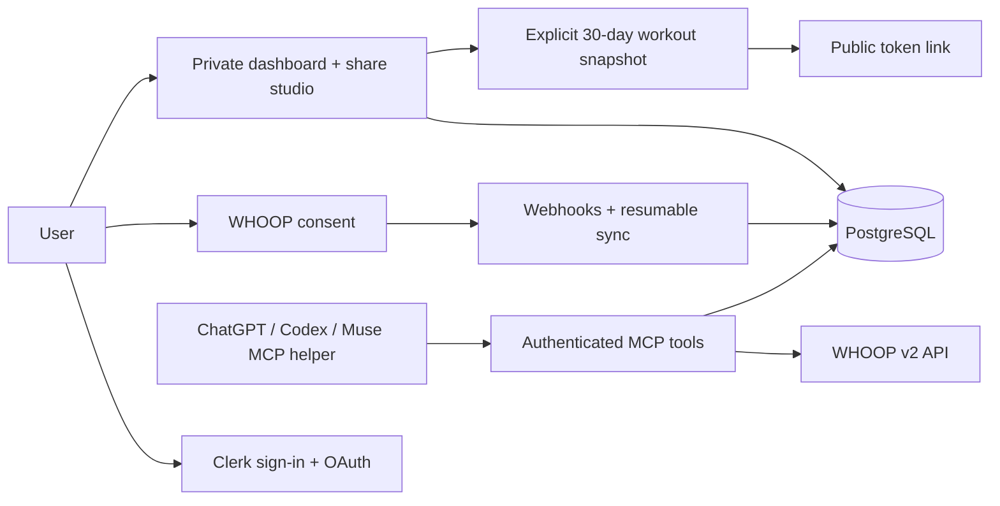

<p align="center"></p>
<p align="center">
<a href="https://whooper.eazylee.si"></a>
<a href="https://github.com/EazyLee30/whooper-2.0/actions/workflows/checks.yml"></a>


</p>
<p align="center"><a href="README.md">English</a> · <a href="README.zh-CN.md">简体中文</a> · <a href="README.zh-TW.md">繁體中文</a></p>

# Whooper

Your personal WHOOP dashboard, workout journal and share studio — alongside a coaching plugin for ChatGPT and Codex, with authenticated MCP access from Muse.

Sign in to see recovery, sleep and training in one private workspace, inspect Strength Trainer sets, and choose how a workout becomes a shareable page. Whooper also carries forward the original GPT's coaching instructions and all six WHOOP data domains through authenticated, read-only MCP tools. Each person connects their own WHOOP account.

**[Open the public trial](https://whooper.eazylee.si)** · [Download plugin](https://github.com/EazyLee30/whooper-2.0/releases/tag/v0.2.1) · [Plugin source](plugin) · [Privacy](https://whooper.eazylee.si/privacy)

## What you can do

| Data | Tools and behavior |
| --- | --- |
| Profile & body measurements | Read your account profile and current body measurements |
| Recovery & cycles | List records, inspect details and retain calibration / score states |
| Sleep | Main sleep, naps, stages and original WHOOP scores |
| Workouts | Activity records, strain and detailed measurements |
| Daily picture | Link recovery, sleep and workouts using cycle IDs and your timezone |
| History | Cursor pagination, resumable sync and cache coverage checks |

Ask: “Compare my recovery and sleep over the last seven days.” Or: “Given today's readiness, how should I train?” Missing data stays missing; pending scores are never silently turned into zero.

## Dashboard and share studio

The home page introduces Whooper to visitors. Signing in opens the private `/dashboard`; the dashboard, workout details and studio require your account. Choose a date, inspect the latest seven days of activity, and select a workout for its recorded sets, reps and loads. Strength Trainer details require the optional connection described below. Empty accounts show clearly labeled template examples; examples cannot be published as your workouts.

The theme picker brings over eight palettes from the personal github.io site: **Flexoki, Monochrome, Latte, Tokyo Night, Gruvbox, Nord, Rosé Pine and Matrix**. Theme and presentation are separate choices.

| Template | Presentation |
| --- | --- |
| `ledger` · Training ledger | Original handwritten training-sheet artwork and layout from the personal workout page, with dates and exercise values overlaid on the paper |
| `illustrated` · Movement guide | Original workout movement-card layout with three-frame [Workout Guide](https://github.com/bryllim/workout-guide) illustrations and individual sets |
| `journal` · Training journal | An editorial workout log inspired by the github.io typography |
| `pulse` · Performance card | A compact presentation of the session's recorded metrics and exercises |

Open the full preview to export the two original presentations (`ledger` and `illustrated`) as PNGs. Longer training sheets are paginated. Artwork credit and license notices are preserved; Workout Guide illustrations use CC BY-SA 4.0.

The studio stays private until you select **Create share page**. Each new link stores an independent snapshot with your title, template and theme, workout timing, activity, duration, strain and calories, plus available completed strength exercises, sets, reps, loads, units and total volume. It excludes recovery, sleep, heart-rate measurements, profile/member identity and credentials. A snapshot does not update with later WHOOP changes. Anyone holding its link can view it without signing in until it expires after 30 days or you revoke it from **My links**. Deleting your Whooper account data also deletes its shares.

| Endpoint | Access and purpose |
| --- | --- |
| `GET /api/dashboard?date=YYYY-MM-DD` | Signed in: daily metrics and seven-day workout context; date is optional |
| `GET /api/dashboard/strength?workout=ID` | Signed in: completed strength details for an owned workout |
| `GET /api/shares` | Signed in: list your share links |
| `POST /api/shares` | Signed in: create a snapshot from `workoutId`, `template`, `theme` and `title` |
| `DELETE /api/shares/ID` | Signed in: revoke one of your links |
| `GET /share/TOKEN` | Public read-only page for an active snapshot |

## Try it

1. Open the trial and sign in to your private dashboard.
2. Connect WHOOP and approve the requested read scopes.
3. Browse your workouts, choose a template in the share studio, and preview or create a share page. Connect Strength Trainer in account settings for individual exercise sets.
4. For AI coaching, install the package in a client that supports portable plugins. The package lives in `plugin/`; it contains `plugin.json`, `mcp.json`, the coaching skill and brand assets.
5. Authorize the plugin with the same Whooper account. Ask it to check your connection before requesting health data.

The MCP endpoint is `https://whooper.eazylee.si/api/mcp`. Authenticated MCP clients receive coaching guidance in the initialization response and discover tools through `tools/list`; the complete plugin also packages that guidance as a portable skill with client metadata and brand assets.

**Trial status:** this deployment uses a Clerk development instance. The WHOOP app is currently Sandbox: up to 10 connected members (1 connected when checked on October 10, 2026). Public source and a downloadable package do not mean approval or listing in the universal plugin directory. Real-account acceptance testing and directory submission are tracked separately.

## Muse support

Muse can query Whooper through the same authenticated, read-only MCP endpoint. **Verified on October 15, 2026:** OAuth authorization and refresh-token rotation, discovery of all 14 tools, connection status, daily snapshots, sleep/recovery/workout details, history coverage and sync status. Fresh-process queries and three concurrent helper processes also passed.

The tested setup uses a **local helper in the Muse agent's VM**, not a native Muse connector or an installation of the portable plugin. The helper and its credentials are provisioned separately in that environment; they are not included in this repository. Once configured, ask Muse “How did I sleep last night?” or “Compare my recovery and workouts.”

### Connect Muse

1. Sign in to [Whooper](https://whooper.eazylee.si) and connect your own WHOOP account first.
2. In Clerk → Configure → Developers → OAuth applications, register `https://whooper.eazylee.si/connect/muse` as an exact redirect URI on the public OAuth client used by Whooper. For your own deployment, substitute your application URL and client ID. Keep the existing client callbacks and consent screen enabled.
3. Ask Muse to configure a persistent MCP helper for `https://whooper.eazylee.si/api/mcp`. It must generate a fresh PKCE S256 verifier/challenge and random `state`, retain the verifier privately, and request `openid offline_access` with the MCP endpoint as `resource`. Use the authorization/token endpoints published by the authorization server's discovery document. The public trial's client ID is `EsrIyDTsryA3lxTL`.
4. Have Muse show the authorization URL as plain text in a code block. Copy it into an external browser's address bar, sign in with the same Whooper account and approve. In the tested Muse client, clicking an OAuth link inside chat opened an Accounts dialog that closed without completing the flow.
5. The callback page displays a one-time authorization code. Return it only to the trusted Muse session that holds the matching verifier. The helper must validate `state` and exchange the code with that verifier and the exact redirect URI. This is a manual code handoff; the callback page does not automatically exchange or store tokens.
6. Verify `initialize`, `tools/list`, `get_connection_status` and a real `get_daily_snapshot` call. Persist Clerk credentials privately in the Muse VM (owner-only permissions, such as `0600`), serialize refresh-token rotation and atomically save the replacement credentials. Never publish access/refresh tokens or the PKCE verifier in chat, memory files or GitHub. WHOOP tokens remain encrypted on the Whooper server; requested health records are returned to the Muse conversation.

If Clerk reports a redirect mismatch, check the exact callback in its allowlist. If a helper discovers no tools, parse Streamable HTTP JSON/SSE responses by JSON-RPC request ID; do not assume the final SSE event contains the result. Follow the negotiated MCP initialization/protocol lifecycle. The tested server is stateless and does not return an `Mcp-Session-Id`. Revoking the Clerk grant or losing the VM credentials requires reconnecting Muse; connecting Muse does not replace the separate WHOOP authorization.

## Run your own instance

Node.js 24, PostgreSQL, a Clerk OAuth application and a WHOOP developer application are required.

Before deploying the dashboard and sharing features, apply all database migrations, including **`0004_training_shares`**, with `npx prisma migrate deploy`. This migration creates the snapshot table and its account-deletion cascade. Keep `NEXT_PUBLIC_APP_URL` set to your deployment's canonical origin so generated share links use the right host.

```sh
npm ci
cp .env.example .env.local
# Fill in your own configuration; never commit credentials.
npx prisma migrate deploy
npm run dev
```

Configure WHOOP's callback as `<APP_URL>/api/auth/whoop/callback` and webhooks as `<APP_URL>/api/webhooks/whoop`. Configure Clerk's public OAuth client with PKCE and the client's required callback URLs. Update the plugin endpoint and OAuth client ID for your deployment.

```sh
npm test
npm run lint
npm run build
```

Daily reconciliation runs through `/api/jobs/reconcile` with a server-side cron secret. Historical sync resumes from stored page checkpoints. Tokens are encrypted at rest; health records are cached server-side. Requested records are sent to the ChatGPT, Codex or configured Muse conversation where you make the query.

## Architecture



Independent community project; not affiliated with or endorsed by WHOOP. Coaching is informational and does not provide medical diagnosis.

### Public workout accountability

`GET /api/public/workout` powers EazyLee's personal website. A separately opted-in `public_workout_profiles` row fixes the owner server-side; clients cannot choose an account. It exposes only today's workout-recorded boolean, Shanghai date, check timestamp and daily nudge count. It does not expose workout details, WHOOP member IDs, tokens, sleep or recovery data. WHOOP reads reuse the existing refresh-safe v2 client, with a 60-second database cache and a refresh lease. A failed/stale read is `unavailable`, never an assumed missed workout.

`POST /api/public/workout` accepts `{ "visitor": "<browser UUID v4>", "date": "YYYY-MM-DD" }` from the personal site's allowed origins. One browser can nudge once per Shanghai day; a database unique key makes concurrent retries idempotent. A daily hashed network limit caps obvious repeat voting at five browsers per network. No raw IP address is stored. This is an anonymous browser count, not a verified person count. The nudge is accepted only while a fresh check confirms no workout record. The counter persists in Postgres; frontend storage only remembers the anonymous browser UUID. No outbound notification is sent.

Apply `prisma migrate deploy` before releasing this endpoint. Opt-in is a database administrator action: insert the explicit owner's WHOOP member ID into `public_workout_profiles` with slug `eazylee`, timezone `Asia/Shanghai`, enabled true. Never auto-select the first member in a multi-user database.

### Optional Strength Trainer

Apply `npx prisma migrate deploy` before deploying this version (`0003_strength_session`). After connecting WHOOP OAuth, sign into the **same WHOOP account** in the Strength Trainer section of connection settings. SMS, authenticator and email codes are supported. Passwords are not stored; the separate App session is encrypted with the existing token key, refreshed under a database lock, and removable independently or through account deletion.

New read tools: `list_strength_workouts` (follow cursors even for empty filtered pages), `get_strength_workout` (exercise aggregates), `get_strength_exercise` (individual sets/history and PRs), and `get_strength_personal_records`. Original fields and units are preserved. Match exercise-history sessions to workout dates. Strength reads are live and excluded from OAuth backfill/cache coverage.

Protocol research: [Totem](https://github.com/thebriangao/totem), specifically its Cognito proxy, cardio-details and weightlifting-service readers. These are private WHOOP App endpoints and may change; public OAuth alone cannot access them. Live compatibility requires signing in and reading a real account after deployment.

### Public personal workout page

The enabled `eazylee` public profile can publish minimized completed Strength Trainer
sessions at `GET /api/public/workout/strength`, with optional `date=YYYY-MM-DD` and
`workout=UUID`. Workout IDs are matched against that owner's dated workout list;
this endpoint never accepts a user or connection identity. Results contain date,
duration, strain, volume and completed exercise sets only. Unknown loads remain
null, planned unlogged rows are omitted, and explicit lb values stay labeled lbs.
The server caches reads for 60 seconds and checks profile/session access before
using cached data. Disabling the profile immediately disables public reads.
`/api/public/workout` also returns seven days of deduplicated nudge counts and
WHOOP workout status, with unknown status on failed reads. The personal site
refreshes these public feeds directly; no Muse polling or token in GitHub is needed.
