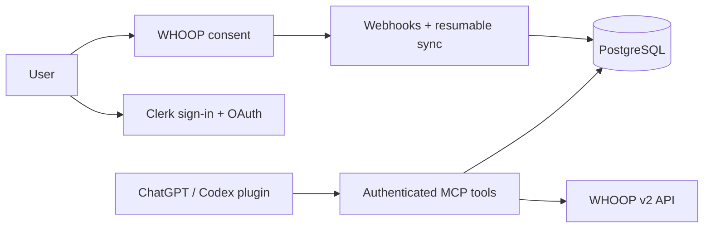

<p align="center"></p>
<p align="center">
<a href="https://whooper.ccwu.cc"></a>
<a href="https://github.com/EazyLee30/whooper-2.0/actions/workflows/checks.yml"></a>


</p>
<p align="center"><a href="README.md">English</a> · <a href="README.zh-CN.md">简体中文</a> · <a href="README.zh-TW.md">繁體中文</a></p>

# Whooper

Your personal recovery, sleep and training coach — now a plugin for ChatGPT and Codex.

Whooper carries forward the original GPT's coaching instructions and all six WHOOP data domains. The plugin combines a coaching skill with authenticated, read-only MCP tools. Each person signs in and connects their own WHOOP account.

**[Open the public trial](https://whooper.ccwu.cc)** · [Download plugin](https://github.com/EazyLee30/whooper-2.0/releases/tag/v0.2.1) · [Plugin source](plugin) · [Privacy](https://whooper.ccwu.cc/privacy)

## What you can do

| Data | Tools and behavior |
| --- | --- |
| Profile & body measurements | Read your account profile and current body measurements |
| Recovery & cycles | List records, inspect details and retain calibration / score states |
| Sleep | Main sleep, naps, stages and original WHOOP scores |
| Workouts | Activity records, strain and detailed measurements |
| Daily picture | Link recovery, sleep and workouts using cycle IDs and your timezone |
| History | Cursor pagination, resumable sync and cache coverage checks |

Ask: “Compare my recovery and sleep over the last seven days.” Or: “Given today's readiness, how should I train?” Missing data stays missing; pending scores are never silently turned into zero.

## Try it

1. Open the trial and sign in.
2. Connect WHOOP and approve the requested read scopes.
3. Install the package in a client that supports portable plugins. The package lives in `plugin/`; it contains `plugin.json`, `mcp.json`, the coaching skill and brand assets.
4. Authorize the plugin with the same Whooper account. Ask it to check your connection before requesting health data.

The MCP endpoint is `https://whooper.ccwu.cc/api/mcp`. Adding that endpoint alone provides tools; install the complete plugin to include the original coaching instructions too.

**Trial status:** this deployment uses a Clerk development instance. The WHOOP app is currently Sandbox: up to 10 connected members (1 connected when checked on October 10, 2026). Public source and a downloadable package do not mean approval or listing in the universal plugin directory. Real-account acceptance testing and directory submission are tracked separately.

## Run your own instance

Node.js 24, PostgreSQL, a Clerk OAuth application and a WHOOP developer application are required.

```sh
npm ci
cp .env.example .env.local
# Fill in your own configuration; never commit credentials.
npx prisma migrate deploy
npm run dev
```

Configure WHOOP's callback as `<APP_URL>/api/auth/whoop/callback` and webhooks as `<APP_URL>/api/webhooks/whoop`. Configure Clerk's public OAuth client with PKCE and the client's required callback URLs. Update the plugin endpoint and OAuth client ID for your deployment.

```sh
npm test
npm run lint
npm run build
```

Daily reconciliation runs through `/api/jobs/reconcile` with a server-side cron secret. Historical sync resumes from stored page checkpoints. Tokens are encrypted at rest; health records are cached server-side. Requested records are sent to the ChatGPT or Codex conversation where you use the plugin.

## Architecture



Independent community project; not affiliated with or endorsed by WHOOP. Coaching is informational and does not provide medical diagnosis.

### Public workout accountability

`GET /api/public/workout` powers EazyLee's personal website. A separately opted-in `public_workout_profiles` row fixes the owner server-side; clients cannot choose an account. It exposes only today's workout-recorded boolean, Shanghai date, check timestamp and daily nudge count. It does not expose workout details, WHOOP member IDs, tokens, sleep or recovery data. WHOOP reads reuse the existing refresh-safe v2 client, with a 60-second database cache and a refresh lease. A failed/stale read is `unavailable`, never an assumed missed workout.

`POST /api/public/workout` accepts `{ "visitor": "<browser UUID v4>", "date": "YYYY-MM-DD" }` from the personal site's allowed origins. One browser can nudge once per Shanghai day; a database unique key makes concurrent retries idempotent. A daily hashed network limit caps obvious repeat voting at five browsers per network. No raw IP address is stored. This is an anonymous browser count, not a verified person count. The nudge is accepted only while a fresh check confirms no workout record. The counter persists in Postgres; frontend storage only remembers the anonymous browser UUID. No outbound notification is sent.

Apply `prisma migrate deploy` before releasing this endpoint. Opt-in is a database administrator action: insert the explicit owner's WHOOP member ID into `public_workout_profiles` with slug `eazylee`, timezone `Asia/Shanghai`, enabled true. Never auto-select the first member in a multi-user database.
