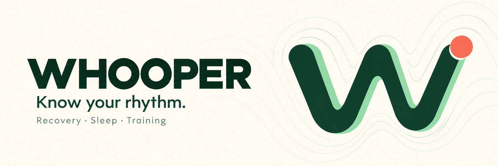

<p align="center"></p>
<p align="center">
<a href="https://whooper.eazylee.si"></a>
<a href="https://github.com/EazyLee30/whooper-2.0/actions/workflows/checks.yml"></a>


</p>
<p align="center"><a href="README.md">English</a> · <a href="README.zh-CN.md">简体中文</a> · <a href="README.zh-TW.md">繁體中文</a></p>

# Whooper

你的 WHOOP 資料看板、訓練日誌與分享頁面庫，同時提供 ChatGPT 和 Codex 教練外掛，並支援 Muse 透過認證 MCP 接入。

登入後，在私人工作台查看恢復、睡眠及訓練，展開 Strength Trainer 逐組紀錄，再為一次訓練選擇分享樣式。同時保留原 GPT 的完整教練指令、六類 WHOOP 資料與認證唯讀 MCP 工具。每位使用者連接自己的 WHOOP 帳號。

**[公開試用](https://whooper.eazylee.si)** · [下載外掛安裝包](https://github.com/EazyLee30/whooper-2.0/releases/tag/v0.2.1) · [外掛原始碼](plugin) · [隱私說明](https://whooper.eazylee.si/privacy)

## 功能

| 資料 | 能力 |
| --- | --- |
| 基本資料、身體資料 | 讀取帳戶資料與身體測量 |
| 恢復、cycle | 分頁清單、詳細資料、校準與評分狀態 |
| 睡眠 | 主睡眠、小睡、階段與原始評分 |
| 訓練 | 活動、strain 與完整指標 |
| 每日快照 | 依 cycle 關係與時區串聯恢復、睡眠、訓練 |
| 歷史紀錄 | 原生游標分頁、可恢復同步、快取涵蓋範圍檢查 |

例如：「分析我最近七天的恢復和睡眠」「依照今天的狀態安排訓練」。缺漏資料保持缺漏，尚未完成的評分不會被當成零。

## 資料看板與分享頁面庫

未登入時首頁展示產品介紹；登入後進入私人 `/dashboard`。看板、訓練明細及分享工作室均須登入。可切換日期、查看近七天活動，並選擇訓練查看已記錄的組數、次數與重量；力量明細需要下方介紹的選用 Strength Trainer 連接。沒有訓練資料時，模板會清楚標示為範例，範例不能作為你的訓練發布。

主題選擇器沿用個人 github.io 的八套配色：**Flexoki、Monochrome、Latte、Tokyo Night、Gruvbox、Nord、Rosé Pine、Matrix**。配色與呈現模板可分別選擇。

| 模板 | 呈現方式 |
| --- | --- |
| `ledger` · 功夫訓練單 | 直接沿用個人 workout 頁的原版手寫訓練單底圖與排版，在紙上疊加日期、動作及訓練資料 |
| `illustrated` · 動作圖鑑 | 沿用原版動作卡片配置，搭配 [Workout Guide](https://github.com/bryllim/workout-guide) 三幀動作插畫與逐組紀錄 |
| `journal` · 訓練日誌 | 以 github.io 字體排版為靈感的訓練日誌 |
| `pulse` · 數字脈搏 | 以本次訓練的實際指標與動作構成資料卡片 |

在完整預覽中可將兩種原版呈現（`ledger`、`illustrated`）匯出為 PNG；較長訓練單自動分頁。保留插畫來源及授權說明，Workout Guide 插畫使用 CC BY-SA 4.0。

點選「建立分享頁面」前，工作室內容僅自己可見。每個連結儲存獨立快照，包含自訂標題、模板及主題，以及本次訓練的時間、活動、時長、負荷、熱量，以及可用的已完成力量動作、組數、次數、重量、單位和總訓練量；不包含恢復、睡眠、心率測量、個人資料／會員身分及憑證。快照不會隨後續 WHOOP 資料變化更新。任何持有連結的人均可免登入查看，30 天後失效，也可在「我的分享」隨時撤銷；刪除 Whooper 帳號資料會一併刪除分享。

| 介面 | 存取與用途 |
| --- | --- |
| `GET /api/dashboard?date=YYYY-MM-DD` | 須登入：當天指標及近七天訓練，日期可省略 |
| `GET /api/dashboard/strength?workout=ID` | 須登入：自己某次訓練的已完成力量明細 |
| `GET /api/shares` | 須登入：列出自己的分享連結 |
| `POST /api/shares` | 須登入：透過 `workoutId`、`template`、`theme`、`title` 建立快照 |
| `DELETE /api/shares/ID` | 須登入：撤銷自己的分享連結 |
| `GET /share/TOKEN` | 公開：有效訓練快照的唯讀頁面 |

## 使用

1. 開啟試用網址，登入進入私人工作台。
2. 連接 WHOOP，批准所需的唯讀權限。
3. 瀏覽訓練，在分享頁面庫選擇模板並預覽或建立分享；在帳號設定連接 Strength Trainer 後可查看逐組動作資料。
4. 如需 AI 教練，在支援 portable plugin 的用戶端安裝 `plugin/` 中的完整外掛套件。
5. 用同一 Whooper 帳號授權外掛，先檢查連線，再查詢資料。

MCP 網址：`https://whooper.eazylee.si/api/mcp`。認證 MCP 用戶端會在初始化回應中取得教練指引，並透過 `tools/list` 探索工具；完整外掛還將指引封裝為 portable skill，並附帶用戶端中繼資料與品牌素材。

**試用狀態：**目前使用 Clerk 開發執行個體；WHOOP 應用程式目前為 Sandbox，最多連接 10 人（2026-10-10 檢查時已連接 1 人）。公開原始碼與提供安裝包不代表已通過通用外掛目錄審核。真實帳號驗收與目錄提交分別進行。

## Muse 支援

Muse 可透過同一認證唯讀 MCP 介面查詢 Whooper。**2026-10-15 已驗證：**OAuth 授權、更新權杖輪替、全部 14 個工具的自動探索、連線狀態、每日快照、睡眠／恢復／訓練詳情、歷史涵蓋範圍及同步狀態；新程序查詢及三個並行 helper 程序也通過測試。

實測方案是在 **Muse 智能體的 VM 內設定本機 helper**，不是 Muse 原生 connector，也不是安裝 portable plugin。helper 與憑證須在該環境個別設定，本儲存庫不包含該腳本。設定完成後，可直接問 Muse：「昨晚睡得怎麼樣？」「比較我的恢復與訓練情況。」

### 接入 Muse

1. 先登入 [Whooper](https://whooper.eazylee.si)，連接自己的 WHOOP 帳戶。
2. 在 Clerk → Configure → Developers → OAuth applications 中，為 Whooper 使用的公開 OAuth 用戶端登記精確回呼網址 `https://whooper.eazylee.si/connect/muse`。自行部署時替換網域及 client ID，保留既有回呼網址與授權確認頁。
3. 讓 Muse 為 `https://whooper.eazylee.si/api/mcp` 設定持久化 MCP helper：產生新的 PKCE S256 verifier/challenge 與隨機 `state`，私下保留 verifier，以 `openid offline_access` 為 scope、MCP 網址為 `resource` 發起授權。授權與權杖端點從授權伺服器的 discovery 文件讀取；公開試用的 client ID 為 `EsrIyDTsryA3lxTL`。
4. 讓 Muse 將授權 URL 放在純文字程式碼區塊，複製到外部瀏覽器網址列，以同一 Whooper 帳號登入並批准。實測 Muse 用戶端直接點擊聊天內的 OAuth 連結會開啟 Accounts 視窗，隨後關閉而未完成流程。
5. 回呼頁顯示一次性授權碼，只交給持有相符 verifier 的可信 Muse 對話。helper 必須驗證 `state`，使用該 verifier 與完全一致的回呼網址交換權杖。這是手動授權碼交接，回呼頁不會自動交換或儲存權杖。
6. 驗證 `initialize`、`tools/list`、`get_connection_status` 及真實 `get_daily_snapshot`。Clerk 憑證私存於 Muse VM，採用僅擁有者可讀寫的權限（如 `0600`）；更新權杖輪替須依序執行並以原子操作儲存新憑證。Access／refresh token 與 verifier 不得寫入聊天、記憶檔或 GitHub。WHOOP 權杖仍由 Whooper 伺服器端加密儲存，查詢出的健康資料會回傳 Muse 對話。

若 Clerk 回報回呼不符，檢查允許清單中的精確網址。若 helper 探索的工具為空，應依 JSON-RPC 請求 ID 解析 Streamable HTTP 的 JSON／SSE 回應，不要預設最後一幀就是結果，並遵循協商後的 MCP 初始化與協定流程。實測服務為無狀態模式，不回傳 `Mcp-Session-Id`。撤銷 Clerk 授權或遺失 VM 憑證後須重新連接 Muse；Muse 授權與 WHOOP 帳戶授權是兩個獨立環節。

## 自行部署

需要 Node.js 24、PostgreSQL、Clerk OAuth 應用程式及 WHOOP 開發者應用程式。

發布看板與分享功能前，務必執行 `npx prisma migrate deploy` 套用全部遷移，包含 **`0004_training_shares`**。此遷移建立訓練快照資料表，並在刪除帳號資料時串聯刪除分享。將 `NEXT_PUBLIC_APP_URL` 設為部署的正式來源網址，讓產生的分享連結使用正確網域。

```sh
npm ci
cp .env.example .env.local
# 填入自己的設定，請勿提交金鑰
npx prisma migrate deploy
npm run dev
```

WHOOP 回呼：`<APP_URL>/api/auth/whoop/callback`；Webhook：`<APP_URL>/api/webhooks/whoop`。Clerk 公開 OAuth 用戶端須啟用 PKCE 並設定回呼網址。修改外掛中的服務網址與 OAuth client ID。

驗證：`npm test`、`npm run lint`、`npm run build`。歷史同步支援分頁接續；每日 cron 使用伺服器端金鑰。權杖加密儲存，健康紀錄快取於資料庫；查詢的資料會回傳發起請求的 ChatGPT、Codex 或已設定的 Muse 對話。

獨立社群專案，與 WHOOP 無關聯或背書。教練建議供資訊參考，不提供醫療診斷。

### Strength Trainer（選用）

部署前執行 `npx prisma migrate deploy`，套用 `0003_strength_session`。先連接 WHOOP OAuth，再於連接設定登入**同一 WHOOP 帳號**的 Strength Trainer。支援簡訊、驗證器與郵件驗證碼；密碼不儲存，獨立 App 工作階段以現有金鑰加密並自動更新，可單獨中斷連接。

新增 `list_strength_workouts`、`get_strength_workout`、`get_strength_exercise`、`get_strength_personal_records` 工具，分別讀取訓練清單、動作彙總、逐組次數/重量歷史及個人紀錄。空白篩選頁仍須沿用 `nextCursor` 翻頁；保留原始欄位和單位，動作歷史須按日期比對訓練。

參考 [Totem](https://github.com/thebriangao/totem) 的私有 WHOOP App 介面，可能隨上游更新失效。此資料即時按需讀取，不計入 OAuth 歷史同步覆蓋率。部署後需實際登入及查詢自己的訓練以確認相容性。
